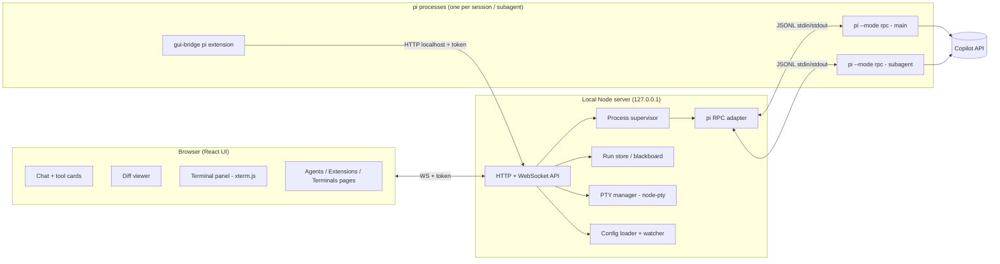

# Pi GUI Harness — Build Plan

_Last updated: 2026-11-03_

## 1. Goal and constraints

Build a local GUI for the **pi** coding agent so day-to-day agent work is faster and easier to follow than in the terminal.

**Constraints**
- Only the **Copilot API** is available. Claude Code, OpenCode and the Copilot CLI are not options.
- pi already works with the Copilot API in the terminal. The GUI drives pi and never replaces it.
- Work machine: assume restricted installs and security review. Keep the footprint small and local-only.

**Success looks like**
- Everything currently done in pi's TUI can be done in the GUI, plus:
  - readable tool output
  - real diffs
  - session history
  - subagents
  - an embedded terminal running Metro
- pi upgrades don't break the app (or break only the adapter layer).
- Agent and Metro crashes never take down the UI.

---

## 2. Architecture



**Key decisions**
- **pi in RPC mode, one process per session and per subagent.** This gives process isolation, a guaranteed abort (kill), a stable wire contract, and pi upgrades independent of the app.
- **The server owns all processes**: pi sessions, subagents and terminals. The UI is just a view, so a page reload loses nothing.
- **Browser UI, not a desktop app (v1).** Nothing to package or get approved. Wrapping it in Electron is optional later.
- **One small pi extension of our own (`gui-bridge`)** adds the GUI-aware tools: `subagent`, `notes_read`, `notes_append` and `terminal_read`. It calls back to the server over localhost.
- **No third-party pi extensions** on the work machine unless vetted.

---

## 3. Tech stack

| Layer | Choice | Why |
|---|---|---|
| Monorepo | pnpm workspaces + TypeScript | Shared protocol types between server, UI and extension |
| Server | Node 20+, Fastify (or Hono) + `ws` | Simple, fast, good WebSocket support |
| Validation | `zod` | Validate RPC records, configs and agent frontmatter |
| UI | React + Vite + Zustand | Familiar stack; Zustand keeps streaming state simple |
| Message list | `react-virtuoso` (or similar) | Long sessions with thousands of events stay smooth |
| Diff viewer | Monaco DiffEditor | VS Code-grade side-by-side diffs |
| Terminal | `node-pty` + `@xterm/xterm` + `@xterm/addon-fit` | Real TTY (needed for Metro's interactive keys and colours) |
| Frontmatter | `gray-matter` | Parse agent `.md` definitions |
| File watching | `chokidar` | Hot-reload agents, terminals and extension configs |

**Repo layout**
```
pi-gui/
  packages/
    protocol/      # shared TS types: RPC records, WS messages, configs
    server/        # adapter, supervisor, PTY manager, config, API
    ui/            # React app
    pi-extension/  # gui-bridge: subagent, notes_*, terminal_read tools
```

---

## 4. Core modules (server)

### 4.1 pi RPC adapter
- Spawns `pi --mode rpc` with `cwd`, provider/model flags and the extension list. Pin the pi version and check `pi --help` for exact flags.
- **Framing:** read stdout as a byte stream and split on `\n` only, tolerating a trailing `\r`. **Do not use Node `readline`**: it also splits on U+2028/U+2029, which are valid inside JSON strings.
- Correlates commands and responses via `id`. Exposes a typed API: `prompt`, `steer`, `followUp`, `abort`, model/thinking setters, and the session commands.
- Emits normalized events to the event bus. Treat `agent_end` as the end of one run only, since retries, compaction and follow-ups can continue after it.
- Reference: pi's `docs/rpc*.md` and `src/modes/rpc/rpc-client.ts`, shipped in the npm package.

### 4.2 Process supervisor
- Tracks every child process: pi sessions, subagents and PTYs.
- Detects crashes and surfaces a "session crashed / restart" state in the UI. Restart policy is configurable.
- Kills the **process group** on stop and on app exit, so no orphaned pi or Metro processes are left behind.
- Enforces a concurrency cap on subagents (default 2–3) to stay under Copilot rate limits.

### 4.3 Event bus and WebSocket API
- One WebSocket per browser tab, multiplexed by channel: `session:<id>`, `terminal:<id>`, `run:<id>`.
- The server keeps a ring buffer per channel, so a reconnecting UI replays recent history.

### 4.4 Config loader
- Loads and watches agents, terminals and extension settings (see §8). Project config overrides global config on a name clash.
- Validates with zod and reports errors in the UI instead of crashing.

### 4.5 Run store / blackboard
- In-memory (optionally persisted) store per run: the subagent tree, briefs, reports and shared notes.
- Backs the `notes_read` / `notes_append` tools and the GUI's live notes view.

---

## 5. Features

### 5.1 Chat
- Streaming assistant messages with markdown and code highlighting.
- **Tool-call cards**, collapsible:
  - **bash:** command and output
  - **read:** file path and preview
  - **edit/write:** opens the diff
- Generic rendering for unknown tools (name, args, output), so new extensions display correctly automatically.
- Input box with **send / steer / queue follow-up** (typing while the agent works), plus abort.
- Model and thinking-level switcher. Token and context meter.

### 5.2 Diffs and changes
- **Changed-files panel** per session (git status of the working tree).
- **Side-by-side diff** per file (Monaco), opened from edit tool cards or the panel.
- **v1:** review after the fact, with per-file revert (git restore, or a pre-edit snapshot kept by the server).
- **v2:** pre-apply approval. A `gui-bridge` hook intercepts write/edit tool calls and waits for accept or reject from the GUI. Verify the tool-call interception API on the pinned pi version.

### 5.3 Sessions
- Sidebar listing sessions per project. Read pi's session files using the format in `docs/session-format.md`, so sessions from pi in the terminal appear too.
- New, resume, rename and delete. Show crashed or running state.

### 5.4 Extension UI handler
- Handles pi's RPC **extension UI records** (dialogs, confirmations, notifications) by rendering them as modals or toasts and sending responses back.
- Required: without it, any extension that asks a question hangs. Check the documented limitations.

### 5.5 Subagents
See §6.

### 5.6 Agents page
- List agent definitions with project/global badges.
- Create/edit form:
  - name and description
  - model dropdown (from pi's model list)
  - thinking level
  - tool checkboxes
  - extension allowlist
  - system prompt editor
- Validation: unique names, tools that exist, valid model.
- Changes take effect on the next spawn, with no restart.

### 5.7 Extensions page
- List installed pi extensions (global and project) with enable/disable toggles.
- Add from a local folder or git URL. Show the source before enabling, and recommend vetted or local only.
- Applying a change restarts the affected pi processes.

### 5.8 Terminals panel
See §7.

---

## 6. Subagents and shared memory

**Principle:** subagents never share a context window. Isolation keeps each context clean and keeps the parent's context small. Information moves through explicit channels.

**Flow**
1. The parent model calls the `subagent` tool (from `gui-bridge`) with `{ agent, task, files?, context? }`.
2. The extension sends `POST /runs/:id/subagents` to the server, with the token passed in via env (`PI_GUI_URL`, `PI_GUI_TOKEN`).
3. The server loads the agent definition and spawns a child `pi --mode rpc` with that agent's model, tools, extensions and system prompt, and sends the brief as the first prompt.
4. The GUI shows the child as a nested panel under the parent's tool card, with live streaming, steer and kill.
5. When the child finishes, the server returns a **structured report** to the extension, which becomes the tool result.
6. A crash, abort or timeout becomes a failed tool result. The parent keeps going.

**Channels**

| Direction | Channel | Contents |
|---|---|---|
| Parent → child | Brief (first prompt) | Task, relevant file paths, decisions so far, constraints. The child reads files itself. |
| Child → parent | Report (tool result) | Summary, files touched, findings, open questions. **Never the full transcript.** |
| Sibling ↔ sibling | Blackboard (`notes_read` / `notes_append`) | Append-only, agent-attributed notes in the server's run store; atomic and visible live in the GUI |
| Mid-run (later) | `message_parent` / `ask_parent` | Progress updates; blocking questions to the parent |
| Long-term | Project memory file (e.g. `AGENTS.md`) | Conventions loaded into every agent's system prompt |

The full child transcript stays in the server for inspection in the GUI.

**File safety**
- Default: parallel subagents are **read-only** (scouts and reviewers). Only one agent writes at a time.
- Later: writers get their own **git worktree**, and their changes are merged back after review.

**Limits**
- Concurrency cap: 2–3 by default.
- Max depth: 1 by default. Children can't spawn children unless the agent definition allows it.
- Per-subagent turn and time limits.

**Agent definition format** (`.pi/agents/<name>.md` or `~/.pi/agent/agents/<name>.md`)
```markdown
---
name: reviewer
description: Reviews diffs for bugs and style issues
model: <copilot model id>
thinking: medium
tools: read, grep, find, ls
extensions: []
maxTurns: 30
---
You review code changes. Report issues with file and line references...
```

---

## 7. Terminals panel

**Goal:** run Metro and other dev commands inside the UI, with full interactivity.

**How it works**
- The server spawns each terminal with `node-pty`, so it's a real TTY. Metro's `r`, `d` and `j` keys and its colours only work with one.
- The browser renders each terminal with xterm.js over its WebSocket channel (input, output, resize).
- Commands run through the **login shell** (`$SHELL -l -c "<command>"`), so nvm, Homebrew and the `.zshrc` PATH all load.

**Features**
- Saved terminal profiles with a **custom working directory and command** (see config below).
- **Run once** for unsaved one-off commands (e.g. `pod install`).
- Bottom panel with tabs that can be collapsed, resized or popped out.
- Scrollback ring buffer on the server: a UI reload replays history while the process keeps running.
- Start, stop and restart buttons. Optional autostart and restart-on-exit.
- **Port check** before start (e.g. 8081 for Metro), with an offer to kill the holder.
- Stop kills the whole process group.
- **`terminal_read` tool** (in `gui-bridge`): the agent can read the last N lines of a named terminal, e.g. to see Metro errors. Read-only. Any future `terminal_write` goes through an approval prompt.

**Config** (`.pi/terminals.json` per project, or `~/.pi/agent/terminals.json` globally; project wins on a name clash)
```json
{
  "terminals": [
    {
      "name": "Metro",
      "cwd": "apps/mobile",
      "command": "npx react-native start --reset-cache",
      "env": { "RCT_METRO_PORT": "8081" },
      "port": 8081,
      "autostart": false,
      "restartOnExit": false
    },
    {
      "name": "iOS",
      "cwd": "~/work/app/apps/mobile",
      "command": "npx react-native run-ios"
    }
  ]
}
```

**Path rules**
- A relative `cwd` resolves against the project root.
- Absolute paths and `~/` are used as written.
- Validate the path exists on save and before start, and show the error in the panel.

**Terminals page form:** name, folder (text field plus picker), command, env key/value rows, port, toggles.

---

## 8. Config files and locations

| What | Project | Global |
|---|---|---|
| Agent definitions | `.pi/agents/*.md` | `~/.pi/agent/agents/*.md` |
| Terminal profiles | `.pi/terminals.json` | `~/.pi/agent/terminals.json` |
| Extensions | pi's own settings/dirs | `~/.pi/agent/extensions/` and pi settings |
| GUI settings | — | `~/.pi-gui/settings.json` (port, layout, concurrency cap) |
| Project memory | `AGENTS.md` | — |

Reusing pi's own locations means everything set up in the GUI also works in pi in the terminal, and the other way round.

---

## 9. Security model

The server can run shell commands, so treat it as sensitive:
- Bind to **127.0.0.1 only**.
- Generate a **random token at startup**. Require it on every HTTP request and WebSocket connection, and pass it to child pi processes via env.
- **Check the `Origin` header** on WebSocket upgrades and reject anything that isn't the UI's origin. This blocks malicious web pages connecting to localhost.
- No telemetry, and nothing sent off the machine beyond what pi already sends to the Copilot API.
- Load no third-party extensions without review. Show an extension's source before enabling it.
- Risky actions (`terminal_write`, later pre-apply approvals) always go through a GUI confirmation.
- **Before using it on real code:** check with the team or security that a self-built local wrapper around pi is acceptable.

---

## 10. Milestones

| # | Milestone | Deliverables | Exit criteria |
|---|---|---|---|
| M0 | **Spike** | Script spawning `pi --mode rpc`, sending a prompt, printing events; `npm install node-pty` on the work machine | Copilot provider works through RPC; node-pty installs; security question raised |
| M1 | **Core chat** | Monorepo, adapter, supervisor, WS API with token, chat UI, tool cards, steer/queue/abort, model switcher | A full coding task in the GUI with no terminal needed; killing pi shows a crash state and restarts cleanly |
| M2 | **Terminals** | PTY manager, xterm panel, profiles with custom cwd/command, Run once, scrollback replay, port check | Metro runs in the panel, `r` reloads the app, a UI refresh keeps Metro alive, stopping leaves no orphan on 8081 |
| M3 | **Diffs and changes** | Changed-files panel, Monaco diff, per-file revert | Every agent edit is reviewable side by side and revertible per file |
| M4 | **Sessions** | Sidebar, resume, rename, delete; reads pi's session files | Sessions started in pi in the terminal show up and can be resumed in the GUI |
| M5 | **Extensions** | Extension UI handler; Extensions page | An extension that asks a confirmation works end to end; toggling one restarts affected sessions |
| M6 | **Subagents** | `gui-bridge` extension (`subagent`, `notes_*`), server orchestration, nested panels, blackboard view, limits; Agents page | Parent delegates to 2 parallel read-only subagents, sees their reports, and siblings share notes; a crashed child doesn't kill the parent |
| M7 | **Agent ↔ terminal and polish** | `terminal_read`, command palette, keyboard shortcuts, token/context meter | "Fix the red screen" works without pasting Metro logs |
| M8 | **Optional** | Pre-apply edit approvals, worktrees for parallel writers, `ask_parent`, Electron wrapper | As needed |

M2 is independent of the agent work and can be built first as a quick win.

---

## 11. Risks and open questions

**Risks**
- **pi version drift.** Pin the version. Add contract tests that replay recorded RPC transcripts against the adapter. Keep all pi-specific code in the adapter and extension.
- **Copilot API rate limits.** Cap concurrency and back off on 429s. Show rate-limit state in the UI.
- **`node-pty` native build** may fail on a locked-down machine. Fallback: plain `spawn` (loses Metro's interactive keys) or a prebuilt binary.
- **Extension UI in RPC mode** has documented limitations, so some extensions may not work fully.
- **Long sessions** can bloat the browser. Virtualize the message list and lazy-load tool outputs.
- **Policy approval.** OpenCode was rejected, so get explicit OK before relying on this.

**Open questions**
- Is the work machine Mac or Windows? This affects shell handling, PTY and paths.
- Which Node version is allowed, and are npm packages installable from the public registry or only from an internal mirror?
- Does pi's Copilot provider need any extra config or auth handling when run headless in RPC mode?
- Should sessions also be visible from a phone later (remote access)? If so, plan auth beyond a local token.
